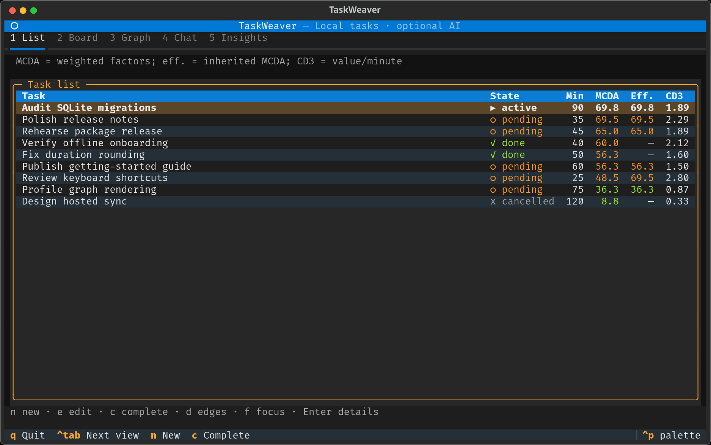
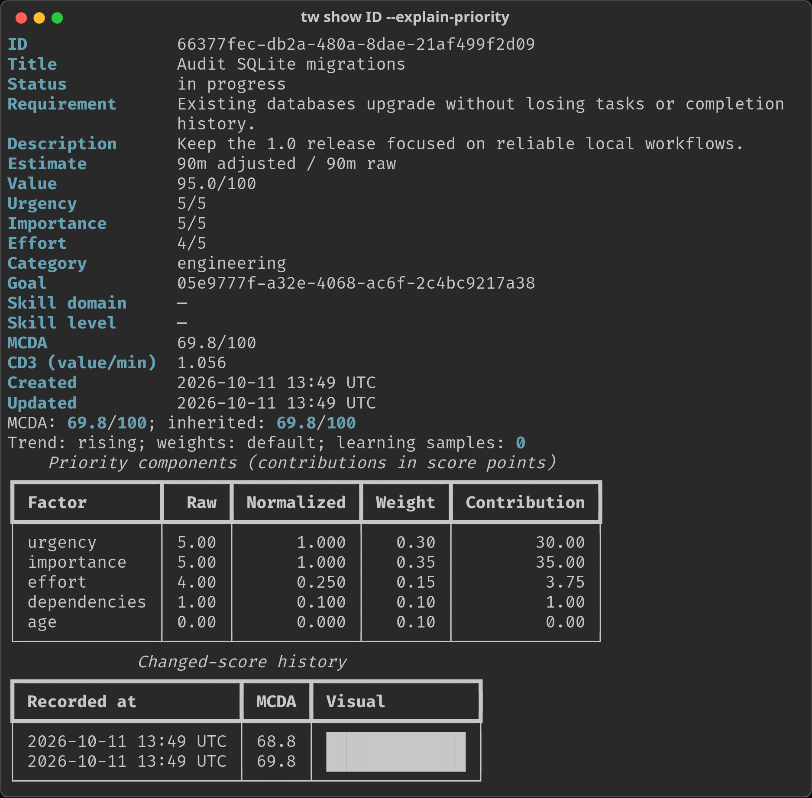
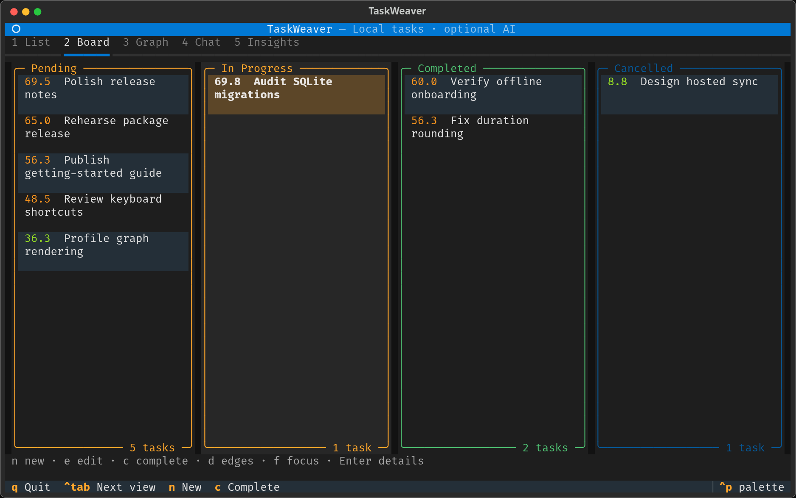
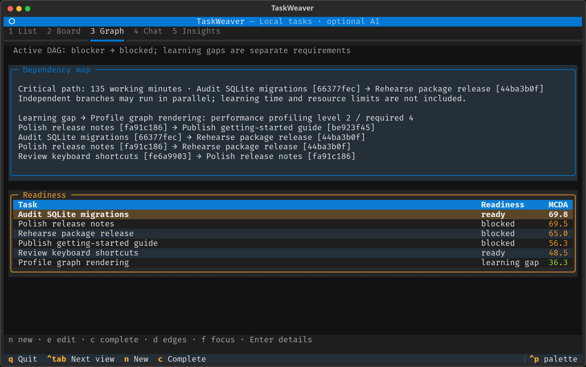

# TaskWeaver

TaskWeaver is a local-first task planner for your terminal. Turn goals into linked tasks, find work that is ready to start, identify learning gaps, and improve duration estimates from recorded completions. The CLI and five-view terminal UI share a SQLite workspace; AI planning and conversation are optional.



## Quick start

Requires Python 3.13+ and [uv](https://docs.astral.sh/uv/). From a checkout:

```sh
uv sync --locked
uv run tw setup
uv run tw
```

Setup defaults to offline task management. In an interactive terminal, `tw` runs setup if needed and opens the TUI; without an interactive terminal, it prints help. `tw tui` opens the workspace directly. `tw` and `taskweaver` are equivalent entry points.

To install this checkout as a standalone tool:

```sh
uv tool install .
tw setup
tw
```

Optional extras install integration SDKs; configure their services and credentials separately in [CONFIG.md](CONFIG.md).

| Extra | Tool installation | From a checkout |
| --- | --- | --- |
| Semantic memory | `uv tool install '.[memory]'` | `uv sync --extra memory` |
| Langfuse observability | `uv tool install '.[observability]'` | `uv sync --extra observability` |

Combine extras with `uv tool install '.[memory,observability]'`.

## Core workflow

Use `uv run tw` instead of `tw` when working from a checkout. Replace `GOAL_UUID`, `TASK_UUID`, and `REVIEW_UUID` with the IDs printed by creation or list commands.

```sh
# Name the outcome, then create tasks linked to it.
tw goals create "Ship a useful tool"
tw create "Prototype CLI" --req "Usable offline" --duration 30 --value 80 --category coding --goal GOAL_UUID
tw create "Review prototype" --req "Ready to merge" --duration 15 --value 60 --goal GOAL_UUID

# Inspect the queue and understand a task's priority.
tw ls --sort priority --limit 10
tw show TASK_UUID --explain-priority

# Review must wait for the prototype: downstream task first, blocker second.
tw createDep REVIEW_UUID TASK_UUID

# Find ready work, the critical path, and short high-value tasks.
tw focus
tw analysis --max-minutes 30 --limit 5

# Record actual minutes and inspect category estimate history.
tw complete TASK_UUID --actual 45 --conclusion "Ready for review"
tw insights --category coding --baseline 30
```

Commands use your configured database. To select another workspace, put `--db PATH` before the command, for example `tw --db ./work.db ls`. Run `tw --help` or `tw COMMAND --help` for the full interface.



## Planning concepts

- **Goals and dependencies:** goals group tasks and report progress. Dependencies form a directed acyclic graph; completing a blocker releases its outgoing blocking edges.
- **MCDA priority:** a 0–100 score combines urgency **.30**, importance **.35**, inverse effort **.15**, dependencies **.10**, and age **.10**. A blocker's effective score inherits the highest score of work downstream. `ls --sort score` uses intrinsic scores; `ls --sort priority` uses effective scores.
- **CD3:** value divided by estimated minutes. `ls --sort cd3` ranks this metric separately from MCDA.
- **Skills and learning gaps:** evidence-backed Dreyfus levels run from **1** (novice) through **2** (advanced beginner), **3** (competent), **4** (proficient), and **5** (expert). `focus` ranks dependency- and skill-ready work by effective MCDA and lists learning gaps separately. Completing tasks does not automatically promote skills.
- **Adaptive estimates:** after **3 valid completions** in a category, estimates use the median actual/raw-duration ratio. The original baseline is preserved to avoid compounding adjustments; `insights` shows sample counts and ratio dispersion.
- **Learned priority weights:** learning starts after **20 completions with valid scoring snapshots**. Explicitly customized weights are protected from automatic changes.
- **Critical path and quick wins:** `analysis` finds the longest estimated working-duration path through active tasks. It assumes independent work can run in parallel and excludes learning time and resource constraints, so it is not a dated schedule. Quick wins are ready tasks of at most **30 minutes** by default, ranked by CD3.

## Terminal UI

Switch views with the number keys or cycle with `Ctrl+Tab`.

| Key | View | What it shows |
| --- | --- | --- |
| `1` | List | Task state, estimates, intrinsic/effective MCDA, and CD3 |
| `2` | Board | Status columns with numeric MCDA scores |
| `3` | Graph | Blocker → blocked dependencies, readiness, and critical path |
| `4` | Chat | AI conversation and local slash commands |
| `5` | Insights | Goals, skills, learning gaps, estimate history, and quick wins |





| Keys | Action |
| --- | --- |
| `j` / `k` | Move down / up |
| `Enter` | Open task details |
| `Space` | Start / pause a task |
| `n` / `e` | Create / edit a task |
| `c` / `x` | Complete / cancel a task |
| `d` | Edit dependencies |
| `f` | Toggle focus mode |
| `g` / `s` | Create a goal / record a skill assessment |
| `r` | Refresh |
| `Ctrl+Enter` / `F2` | Send a chat message |
| `q` / `Ctrl+C` | Quit |

Text editing and dialogs take precedence over workspace shortcuts. Completion asks for actual minutes; cancellation can leave actual time unknown and records no duration-learning sample in that case.

## Chat and memory

Use `tw chat` or the Chat view. Ordinary conversation, planning, breakdown, and review need a configured model; the other slash commands do not need AI. GitHub imports still require network access.

| Command | Purpose |
| --- | --- |
| `/plan GOAL` | Create a goal and linked tasks with planning tools |
| `/breakdown DESCRIPTION` | Decompose work into tasks and dependencies |
| `/review TASK_UUID` | Read-only AI review of task, priority, dependencies, and skills |
| `/focus` | Show ready work and learning gaps |
| `/help [command]` | List commands or show one command's help |
| `/github [OWNER/REPO ...]` | Import issues from supplied or configured repositories; never push |
| `/remember [--category CATEGORY] [--expires ISO_TIMESTAMP] KEY=VALUE` | Store an explicit fact with optional expiry |
| `/forget KEY` | Forget an explicit fact |
| `/memories [CATEGORY]` | List current, unexpired local facts |

Structured arguments accept shell-style quoting, for example `/remember --category preference "work style=short sessions"`. `/plan` and `/breakdown` take prose verbatim.

Memory categories are `preference`, `skill`, `goal`, and `context`. Facts are user-scoped and stored locally by default; chat does not automatically save every utterance. `tw memory` also provides listing, search, updates, expiry, and explicit semantic-memory management. Semantic retrieval is opt-in and requires the `[memory]` extra and configured services. Forgetting is logical deletion, not secure erasure of backups or conversation history.

Numerical agent tools use bounded arithmetic. See the [calculator reference](docs/calculator.md) for operations and limits.

## GitHub sync

```sh
tw github import OWNER/REPO --state open  # Create or update mapped tasks.
tw github sync OWNER/REPO                # Pull existing mapped issues.
tw github sync OWNER/REPO --push         # Explicitly push local status changes.
```

Repeated imports do not duplicate tasks. Pulls reconcile titles, descriptions, and status against the last shared snapshot; divergent edits remain reported conflicts. Local planning fields stay local. `--push` writes only unconflicted status changes, not titles, descriptions, comments, or new issues. Resolve reported conflicts before retrying.

Public reads can be anonymous. Authenticated operations use `GH_TOKEN` or `GITHUB_TOKEN` with the required repository access. With `github_repos` configured, the TUI imports open issues and pulls mapped issues at startup and periodically. Automatic TUI sync is **read-only**.

## Docker

```sh
docker compose build
docker compose run --rm taskweaver setup
docker compose run --rm taskweaver tui
docker compose run --rm taskweaver ls
```

Compose keeps configuration and data under `/data` in a named volume. The image runs as UID/GID 1000; host bind mounts must be writable by that user. Pass credentials at runtime, not as build arguments. To include semantic-memory SDKs, build with `TASKWEAVER_MEMORY=true docker compose build`.

## Reference

- [Configuration and data](CONFIG.md): providers, paths, credentials, migrations, and backups.
- [Contributing](CONTRIBUTING.md): development and release procedures.
- [License](LICENSE): AGPL-3.0.
